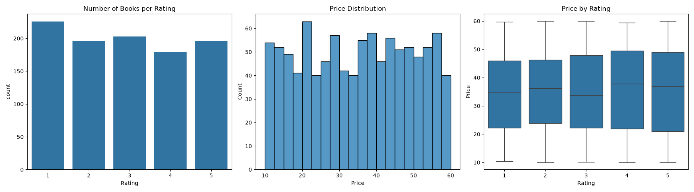

# CodeAlpha Book Scraping Project

Data Analytics internship project at CodeAlpha

## Tasks
1. Web Scraping: scraped 1,000 books (title, price, rating, stock) from books.toscrape.com using BeautifulSoup
2. EDA: cleaned the data and explored ratings, prices, and stock with pandas.
3. Data Visualization: charts made with Matplotlib and Seaborn

## Files
- CodeAlpha_BookScraping.ipynb: full notebook
- books_data.csv: scraped dataset
- book_charts.png: visualizations

